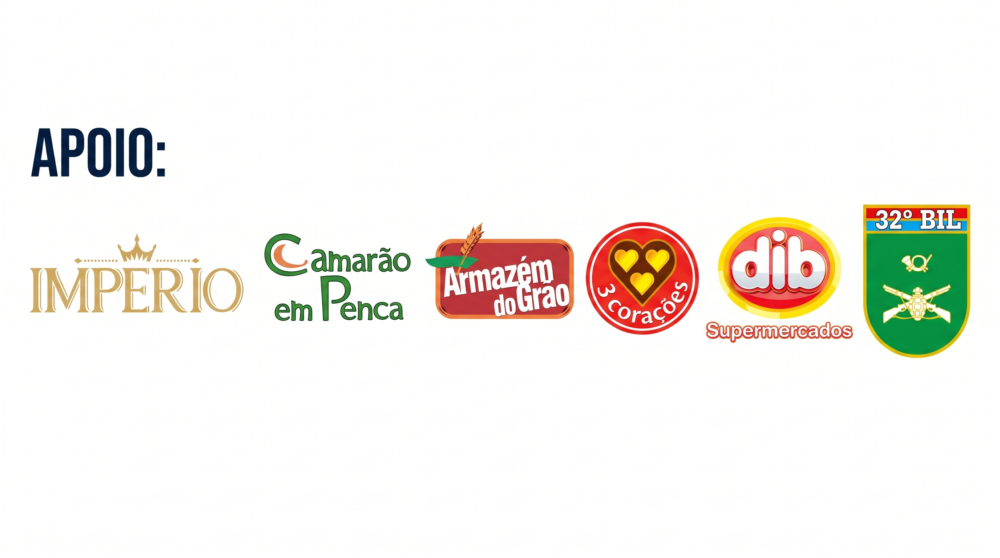

# Olá, eu sou Lawrence 👋

### Desenvolvedor de software | APIs, automação e soluções web

Exploro tecnologias e construo projetos práticos, com interesse em desenvolvimento full-stack, integração de serviços e inteligência artificial.

---

## Sobre mim

- Gosto de transformar ideias em ferramentas úteis e projetos funcionais.
- Tenho interesse em desenvolvimento backend, interfaces web, automação e IA aplicada.
- Este perfil reúne projetos pessoais e estudos; tecnologias e experiências são descritas conforme aparecem nos repositórios públicos.

## Tecnologias e ferramentas

As tecnologias abaixo refletem os projetos atualmente visíveis no perfil e podem mudar conforme novos projetos forem publicados.

## Projetos em destaque

### [AlphaAnalyst Terminal](https://github.com/Lawrencevictor0/alpha-analyst-terminal)
Plataforma experimental de análise de ativos com FastAPI, streaming de respostas, busca na web e integração opcional com modelos de IA.

### [Santander — Bootcamp](https://github.com/Lawrencevictor0/Santander-)
Projeto desenvolvido durante o Bootcamp Santander. Consulte o repositório para ver detalhes e tecnologias do projeto.

## Apoio ao Prêmio de Empreendedorismo Visconde de Mauá 2026

---

*Obrigado pela visita. Fique à vontade para explorar os repositórios e acompanhar os próximos projetos.*

